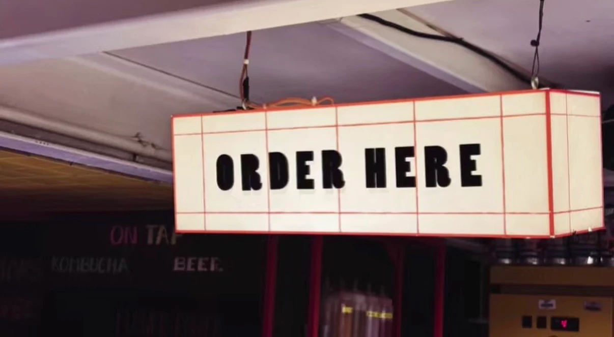
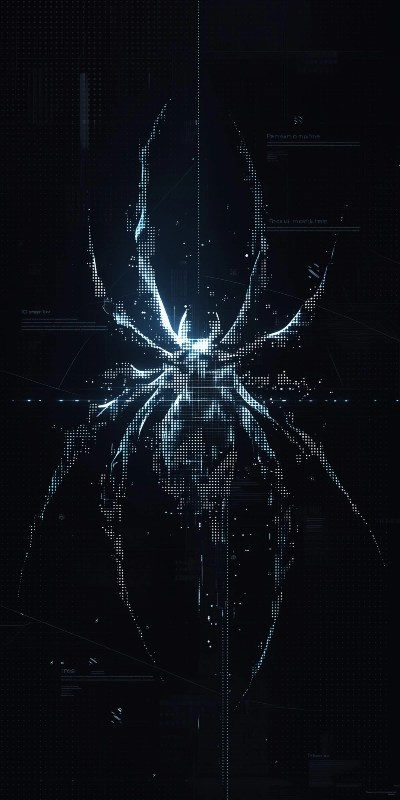
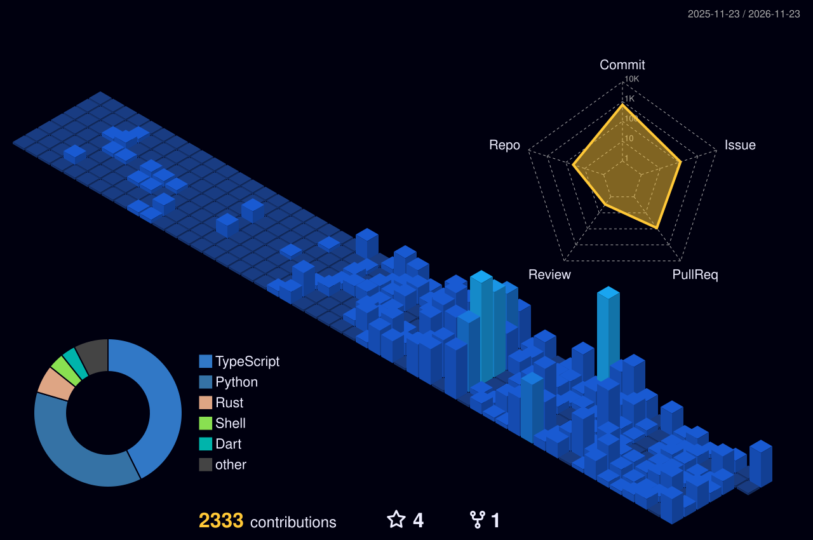

Hi 👋, I am **Samanyu**, an ambitious AI and software engineer. I build LLM agents, retrieval systems, and backends that ship, and I compete on Kaggle and in hackathons. I love learning in public and turning research ideas into working systems ✨

👀 More about me

- 🎓 Fourth year B.E. Civil Engineering at **BITS Pilani, Hyderabad** (Minor in Robotics & Automation), graduating Jul 2027
- 🧪 Founding Engineer (AI/ML) at **Synthsports**; earlier AI + GTM Engineer at **GoMarg**, Founding Full Stack Engineer at **Loomlane**
- 🏆 **Amazon ML Challenge 2026** Rank 144 of 10,942 · Meta OpenEnv finalist (Top 100 of 800+) · IQC WorldQuant BRAIN 2025 finalist
- 📊 Kaggle Notebooks Expert · Playground S6E9 Rank 45 of 3,575
- 🔭 Currently into: game theory (CFR), RAG over contradictory evidence, agent evaluation
- 📍 Hyderabad, India

### 🔥 GitHub Stats

<table width="100%">
<tr>
<td width="62%" valign="top">

</td>
<td width="38%" valign="top" align="center">

</td>
</tr>
</table>

### 📘 My top open source projects

<table width="100%">
<tr><td width="50%"></td><td width="50%"></td></tr>
<tr><td width="50%"></td><td width="50%"></td></tr>
<tr><td width="50%"></td><td width="50%"></td></tr>
<tr><td width="50%"></td><td width="50%"></td></tr>
</table>

### 🛠️ Tech I use

### 📮 Recent activity

<!--START_SECTION:activity-->
1. 🗣 Commented on [#62](https://github.com/Samanyu-dev/pokercfr/pull/62#issuecomment-6977449950) in [Samanyu-dev/pokercfr](https://github.com/Samanyu-dev/pokercfr)
<!--END_SECTION:activity-->

<b>🌙 3D contribution graph</b>

 

